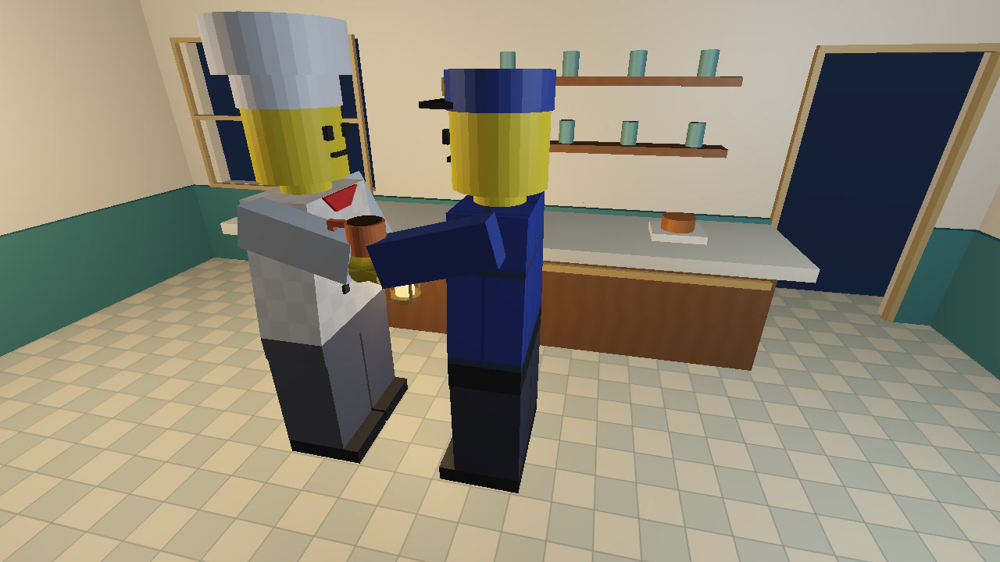

# CS675 Assignment 2: Rendering and Animation — "One Last Cup"

| Name | Roll number |
|---|---|
| Jashanpreet Singh | 23B0985 |
| Shreekar S Naik | 22B4518 |

**YouTube link:** https://youtu.be/Cp4EvwKt8RU



## Declaration

We declare that this submission is our work, built on our Assignment 1 minifigures. We used the references and AI assistance listed under Sources and AI use below. We have reviewed the submitted code, understand the implementation and can explain it in the viva.

## Build and run

```sh
# Ubuntu: sudo apt install libglfw3-dev libglew-dev libglm-dev ffmpeg
# macOS:  brew install glfw glew glm ffmpeg
make
./a2-animate-minifig
```

Run the program from the repository root so that it can find `shaders/`, `textures/` and `keyframes.txt`. `make test` checks keyframe loading, interpolation and the walk cycle. `make clean` removes the executable.

## Story script

The animation is set in a small diner at closing time. The idea was to tell a short and simple story with only two characters and one prop (a coffee cup).

1. **Closing time (0 to 9 s).** The diner is dark. Only the chef's lantern is on. A tired police officer on night patrol switches on his flashlight and turns towards the diner aisle.
2. **The visitor (9 to 19 s).** The camera follows the officer as he walks in through the central aisle. The chef notices him and turns the main lights back on (the pendant lights come on at 12 s and 14 s).
3. **The last cup (19 to 29 s).** The camera switches to the chef. He turns to the counter, reaches forward, picks up the last takeaway coffee and walks into the aisle.
4. **The hand-off (29 to 43 s).** The chef offers the cup and the officer takes it. Both of them pause for a moment during the exchange.
5. **Thank you (43 to 49 s).** A side two-shot where the officer thanks the chef and the chef replies.
6. **Goodbye (49 to 68 s).** The officer walks out through the back doorway with his coffee. There is a short body-mounted shot on the officer between 50.8 s and 54.2 s. The chef waves goodbye and goes back to closing.

The full animation is 2041 frames at 30 FPS, which is about 68 seconds.

## Models

The two minifigures (a chef and a police officer) are the same models we made in Assignment 1. The hierarchy has not been changed:

```text
Torso (root rotation XYZ, translation XYZ)
├── Neck (Y) → Head → Hat
├── Left arm (shoulder X) → Left hand (wrist Y)
├── Right arm (shoulder X) → Right hand (wrist Y)
└── Pelvis
    ├── Left thigh (hip X) → Left lower leg (knee X) → Left foot
    └── Right thigh (hip X) → Right lower leg (knee X) → Right foot
```

Each figure has 15 degrees of freedom. The props (the cup, the lantern and the flashlight) are not part of the hierarchy. We only read the wrist transform from the hierarchy to place them in the hand.

## Scene

The scene is an indoor diner. It has cream walls with teal lower panels, a ceiling, a walnut counter with shelves and containers, side tables with cups and stools and two pendant lamps. The wall panels are built around a real window opening and a real doorway so the skybox can be seen through them. The officer leaves through this doorway at the end. The furniture is placed along the sides so that the central aisle is clear for walking.

All the geometry is made from our box and cylinder primitives from A1. Repeated objects (tables, stools, window bars, shelf containers) are generated with small helper functions and loops in `scene.cpp`.

## Textures

All textures are our own images saved as plain PPM files in `textures/`. We wrote a small PPM loader so we did not need an extra image library.

| Texture | Where it is used |
|---|---|
| chef.ppm | Checked pattern on the chef's torso |
| police.ppm | Blue uniform with stripes and gold trim on the officer's torso |
| tiles.ppm | Floor tiles |
| wood.ppm | Counter and tabletops |
| sky.ppm | Night sky panorama used for the skybox |

Texture coordinates are made by planar projection. For each face we pick the two axes based on the face normal. We use `GL_REPEAT` and mipmaps so the textures still look fine from far away. The texture colour is multiplied with the material colour before lighting so all textured parts are lit properly.

## Lighting

We implemented per-pixel Blinn-Phong shading (this is more than the required Gouraud shading). The vertex shader passes the world-space position and normal (using the inverse transpose of the model matrix). The fragment shader adds ambient, diffuse and specular terms for every light that is switched on. A small tone curve stops the bright hand lights from washing out the colours.

- **Two scene point lights** sit below the two pendant lamps at (-6, 2.78, 0.5) and (6, 2.78, 0.5). One is warm and one is slightly cool. Attenuation is `2.2 / (1 + 0.08d + 0.025d²)`.
- **Chef's lantern** is a warm point light inside a brass cage. It hangs from the chef's left hand so it moves with him.
- **Officer's flashlight** is a cool spotlight attached to the officer's right hand. Its direction comes from the arm and wrist rotation. The cone fades smoothly between 16° and 30° so it makes a soft pool of light on the floor.

All four lights can be switched on and off independently (F1 to F4). The lamp glass and the lantern glow brighter when their light is on. Shadows are not implemented.

## Skybox

A 160-unit cube surrounds the whole scene, all the lights and all three cameras. Its shader looks up the sky panorama using the world-space view direction. The sky is not lit. Everything else in the scene is lit.

## Cameras

All three cameras are perspective cameras with near and far planes of 0.1 and 250. **C** cycles between them.

- **Camera 1 (overview).** Eye at (0, 7.9, 6.4) looking at (0, -0.3, -0.5) with a 74° field of view. It sees the whole room. Its eye and target can be moved with J/K/O and U/V/W and they are saved in the keyframes.
- **Camera 2 (chef follow).** Eye offset (6, 2.8, -1.5) and target offset (0, 1, 0) from the chef's root position, with a 48° field of view. It moves with the chef and always looks at him. We placed it to the side so the reach and pickup of the cup is clearly visible.
- **Camera 3 (officer follow).** Eye offset (1, 2.8, 4.5) and target offset (0, 0.65, 0) from the officer, with a 65° field of view. It moves with the officer and always looks at him.

Camera 3 also has a body-mounted mode (toggled with **F**). In this mode the eye and target are fixed in the officer's local frame, so he stays steady on screen and the diner moves behind him. We used it for a few seconds while he walks out.

## Keymap

| Key | Function |
|---|---|
| Tab | Select the chef or the officer for posing |
| C | Cycle camera: overview / chef follow / officer follow |
| F | Toggle body-mounted mode for the officer camera |
| F1 / F2 | Toggle left / right pendant point light |
| F3 / F4 | Toggle chef lantern / officer flashlight |
| M | Toggle the walk cycle for the selected figure |
| G | Cycle the cup position: counter / chef's hand / officer's hand |
| A / Shift+A | Tilt the cup forward / back |
| X / Y / Z | Rotate the selected figure about X / Y / Z |
| Left / Right | Move the figure along X |
| Up / Down | Move the figure along Y |
| = / - | Move the figure along Z |
| 1 | Rotate neck (Y) |
| 2 / 3 | Rotate left / right shoulder (X) |
| 4 / 5 | Rotate left / right hip (X) |
| 6 / 7 | Bend left / right knee |
| 8 / 9 | Rotate left / right wrist (Y) |
| Shift + joint key | Rotate the joint the other way |
| J / K / O | Move overview camera eye along X / Y / Z |
| U / V / W | Move overview camera target along X / Y / Z |
| Shift + camera key | Move the camera the other way |
| Backspace | Reset the selected figure |
| S | Save the current scene state as a keyframe in `keyframes.txt` |
| L | Load `keyframes.txt` and print how many keyframes were read |
| P | Play the loaded animation |
| R | Play the animation and save every frame as an image |
| Escape | Stop playback or recording; quit when idle |

On macOS you may need to hold Fn with F1 to F4.

## Keyframe format

Each line of `keyframes.txt` is one keyframe. It has an integer frame number followed by 47 numbers in this order:

1. 4 light states (0/1): left pendant, right pendant, lantern, flashlight
2. Camera index (0/1/2)
3. Overview camera eye XYZ and target XYZ
4. Selected figure (0 chef / 1 officer)
5. Chef's 15 values, then the officer's 15 values. For each figure the order is root rotation XYZ, root translation XYZ, neck Y, left and right shoulder, left and right hip, left and right knee, left and right wrist.
6. Cup holder (0/1/2), cup tilt in degrees, officer body-camera mode (0/1), chef walk flag (0/1), officer walk flag (0/1)

The final file has 33 keyframes from frame 0 to frame 2040.

## How the keyframes were made

We organised the story into key poses: the officer enters, the chef turns and reaches for the cup, and the two figures exchange it before the officer leaves. The final `keyframes.txt` stores these poses and their timing at 30 FPS. To edit or add poses, we can use the keyboard controls, set the lights and camera, and press **S**. S appends the current state 10 frames after the last saved keyframe; the first column can then be edited to change the timing. **L** reloads the file and **P** previews the result. Make a copy of `keyframes.txt` before saving new poses.

### Interpolated walk cycle

Walking was the hardest part. To make proper steps with only keyframes we would have needed a new keyframe for every footstep, which would mean many keyframes for each walk and it was very hard to keep the feet on the floor that way.

Instead we only keyframe the start and end position of a walk and set the walk flag (key **M**) on that keyframe. During playback, when the flag is on, the player computes how far the figure has moved along its interpolated path. It divides this distance by the stride length to get the phase of a simple walk cycle, with the two legs half a cycle apart. In the first half of the cycle the leg is on the ground and the hip moves linearly from -14° to +14°. In the second half the leg swings forward with a smoothstep curve and the knee bends up to 35° with a sine curve. The swing is faded in and out over the first and last 0.35 units of the walk so the figure starts and stops from a standing pose. The figure's height is then adjusted so the lowest corner of the feet stays on the floor (we use the leg sizes from A1 for this). Because the phase comes from the distance moved, the steps speed up and slow down with the eased motion which reduces foot sliding. This is an approximate walk cycle, without inverse kinematics or a contact solver. Our figures have no ankle joints so the feet rock a little like a real LEGO toy.

When the flag is off the hip and knee angles stored in the keyframes are interpolated normally. We use this for the standing poses, the reach and the hand-off.

## Playback and interpolation

**L** reads `keyframes.txt`, checks that every line has the right number of values and that the frame numbers increase and prints the number of keyframes read. **P** plays them back.

For every frame between two keyframes we compute `t = (frame - f0) / (f1 - f0)` and interpolate every continuous value (positions, joint angles, camera eye and target, cup tilt) linearly. For root rotations we take the shorter way around so a figure never spins 350° when it should turn 10°. Values that should not be interpolated (light states, camera index, cup holder, body-camera mode, walk flags, selected figure) keep the value of the earlier keyframe until the next keyframe is reached.

Playback runs from a timer callback, not a loop with `sleep()`. GLFW does not have a timer-callback API like GLUT, so we wrote a small `FrameTimer` class in `main.cpp`. Each time round the normal event loop it checks `glfwGetTime()` and calls the frame callback whenever the next 1/30 s deadline has passed. If we had used a loop with `sleep()` the window would freeze between frames, key presses (like Escape) would not be handled and the frame rate would drift because the time spent rendering is added on top of the sleep time.

## Recording and making the movie

Pressing **R** plays the same animation and after every frame is rendered it reads the back buffer with `glReadPixels` and writes it as `frames/frame-00000.ppm`, `frames/frame-00001.ppm` and so on (rows are flipped because OpenGL starts at the bottom). In record mode every frame is saved even if saving is slower than real time, so no frames are skipped. The program checks the free disk space before it starts. If an old `frames/` folder exists it is renamed instead of being deleted.

We joined the frames and added the sound with ffmpeg:

```sh
ffmpeg -framerate 30 -i frames/frame-%05d.ppm -i foley.wav \
       -c:v libx264 -pix_fmt yuv420p -c:a aac -shortest one-last-cup.mp4
```

Instead of music we added foley sound effects. We printed the frame numbers of events from the keyframes (light switches, the cup being picked up and handed over and every footstep from the walk cycle) and placed a sound at each of those times. The sounds are synthesised by us: footsteps (heavier for the officer), light switch and flashlight clicks, a short hum when the pendant lamps come on, a ceramic clink for the cup, a door creak and thud when the officer leaves and a quiet room tone in the background. There is no copyrighted audio. Generated frames, audio and movies are excluded from version control. The final movie is linked at the top of this README.

## Code layout

| File | What it does |
|---|---|
| src/main.cpp | Keyboard commands, frame timer, playback and frame saving |
| src/scene.hpp/.cpp | Scene geometry, cameras, lights, props and scene state |
| src/minifig.hpp/.cpp | The A1 minifigures and their joint controls |
| src/node.hpp/.cpp | Hierarchy nodes, transforms, textures and drawing |
| src/geometry.hpp/.cpp | Box and cylinder meshes with normals and UVs |
| src/animation.hpp/.cpp | Keyframe loading, saving, interpolation and walk cycle |
| src/texture.hpp/.cpp | PPM texture loader |
| src/gl_context.hpp/.cpp | GLFW window and input setup |
| src/shader_util.hpp/.cpp | Shader compiling and linking |
| shaders/ | Vertex shader and per-pixel lighting fragment shader |
| tests/ | Animation logic checks run by `make test` |
| tools/ | Story planning, retiming and movie/audio generation scripts |

## Sources and AI use

- CS475/CS675 OpenGL tutorials (Tutorial 8 for reading the framebuffer to an image)
- GLFW, GLEW and GLM documentation
- LearnOpenGL (Blinn-Phong lighting and spotlights)
- Our own Assignment 1 code for the minifigures
- Claude (Anthropic) and Codex (OpenAI) were used for help with implementation, debugging and documentation. We reviewed the resulting code and decisions and understand the implementation.
